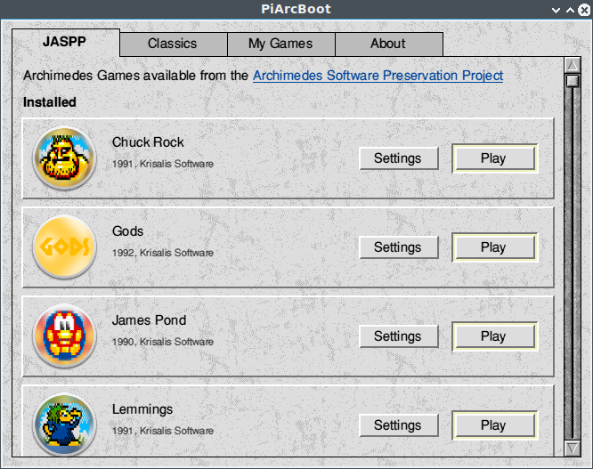

<p align="center"></p>

<h1 align="center">PiArcBoot</h1>

<p align="center"><b>Acorn Archimedes games on the Raspberry Pi.</b><br>A launcher that installs the games JASPP has released, boots each one straight into the game from its floppy images, and gives each its own icon and shortcuts. It needs no commercial ROM.</p>

<p align="center"><a href="../../releases/latest"><b>Download for Raspberry Pi OS</b></a></p>

<p align="center">Discord: <a href="https://discord.gg/88VzuWSYUc">https://discord.gg/88VzuWSYUc</a></p>



## What it does

The Acorn Archimedes was a British home computer of the late 1980s and early 1990s, and [JASPP](https://www.jaspp.org.uk), the Archimedes Software Preservation Project, releases its games with their publishers' permission. PiArcBoot lists 110 of those games. Install fetches one from JASPP, and Play starts it in a window of its own with no ROM to find, no emulator to set up and no desktop to click through.

A game boots behind a splash screen and the window shows it once it has a screen of its own. The machine underneath is an Archimedes emulated by [ArcEm](https://github.com/ArcEm-emu/ArcEm), running [ROO311](https://github.com/jameshansen/ROO311), a free ROM built from the RISC OS Open sources, which comes with PiArcBoot.

The Classics tab has freeware that comes as RISC OS applications rather than disc images: former commercial games that their authors and publishers let Acorn Arcade give away, such as Hamsters, Cycloids, Asylum and Oddball, and the desktop games in RISC OS Open's PackMan sources. Install makes floppy images of a game, and the game starts straight into play as the JASPP games do.

Disc images of your own become games too, with an icon made from a sprite on the disc.

## The games

The JASPP tab is JASPP's own package feed, cut down to the games that ROO311's tests show starting the same way as on RISC OS 3.11 and that run full screen. Games that run inside the RISC OS desktop are left out for now. A game is listed only when JASPP has floppy images to install it from. A game JASPP adds later appears in the list by itself once its floppy images are there, marked as untested.

PiArcBoot contains none of the games. Install downloads a game's floppy images from JASPP, from its package in the feed where that holds every disc, and from JASPP's release folder for the game otherwise. One game, Champions, has no release folder, and installs with the 3 of its 5 discs that its package holds.

PiArcBoot is an unofficial project and isn't affiliated with JASPP or with RISC OS Open Ltd.

## Features

- **The look of RISC OS.** The launcher is drawn by ROOGUI from the RISC OS desktop's own sprites and its Homerton font, with the textured grey work area, action buttons, the default button in its cream surround, option icons, a scroll bar with its arrows and slider, and dialogue boxes with title bars. What it has to say comes in an error box as RISC OS puts one up.
- **Sized by the display.** The launcher follows the display's scale setting, at any factor. Its text is drawn from the font's outlines at the size it appears, so it is as sharp at 150% as at 100%.
- **A menu bar of the system's own.** A game's window has its Game and Switch Floppy menus in the menu bar its system gives a window. On a Raspberry Pi and other Linux desktops that is GTK's, in the desktop's theme, and on Windows it is the window's own menu.
- **Straight into the game.** The keys that start a game are pressed for it while the machine runs flat out behind a splash screen. The picture appears when the game puts up its first screen.
- **Install from one window.** Each game in the list has its icon, year and publisher. Install offers a desktop shortcut and a menu entry, and Settings changes those later or uninstalls the game.
- **Every game is its own program.** A game has its own window, its own icon in the taskbar and its own shortcuts, and starts without the launcher.
- **Any window size, and full screen.** The Game menu has 1x, 2x and 3x, and the window can be dragged to any size or maximized. The picture fills the frame at the largest size that keeps its shape, and stays sharp at every size. Full screen shows it at the largest whole multiple of its pixels that fits.
- **Disk switching.** The Switch Floppy menu changes the disk in the drive, and Alt with a number does the same from the keyboard.
- **Auto switch points.** Set one on the screen where a game asks for a disk, pick the disk, and from then on the disk changes by itself whenever that screen comes up.
- **Classics.** A second tab of free games: Acorn Arcade's freeware releases, and the games in PackMan's package sources that run on RISC OS 3.11. More PackMan sources can be added at the bottom of the tab. Each game's floppy images are made from its application when it is installed, and the game is started and its icon bar icon clicked for you.
- **Your own disc images.** Add Game takes JFD, ADF, ADL and HFE images, or a zip of them, several at once. Names that say which disc they are, such as "Disk 2", "2 of 3" or "Side B", put the discs in order. Its Settings name the game, choose whether the disc boots or which application on it runs, and pick the icon from the sprites found on the discs.
- **Saves are kept and images stay as they were.** What a game writes to its disc goes in a file beside the image, and is there the next time. A game's Settings list its disks, mark each one the game has changed, and make any of them read only.
- **The mouse, captured or not.** A click on the picture gives the mouse to the game and Escape takes it back, as most games want. A game set not to capture the mouse has the RISC OS pointer follow the host's pointer over the picture instead.
- **About.** The About tab names the program's version and what it is made from, with each part's authors, licence and home.
- **Copy protection as the disc has it.** A JFD records each sector's place on the track, its CRC errors, its size and its number, and the floppy controller reads the track as the real drive would, so the games' own disc checks pass.
- **No commercial ROM.** The ROM is ROO311, which is free and comes in the package.
- **Nothing reaches out of the machine.** The emulated computer has floppy drives and nothing else, with no route to the files on yours.


## What works

Tested on x86-64 Linux (Ubuntu 26.04), on a Raspberry Pi 400 with 64-bit Raspberry Pi OS 13, and on Windows 10.

### Works

- All 110 games in the list boot from their first disc to their own screens, started with no window on Linux. Compared with reference pictures taken 35 and 65 seconds after power on, 102 show the same screens and 6 get there later: Black Angel, Empire Soccer 94, Powerband, Raw Power, Silver Ball and Thundermonk, each by 95 seconds
- The two games on 1.6MB discs load through the 82C711 and come off the splash a second sooner than in the reference: Speedball 2 [RPC] shows the reference's opening screen, and Botkiller 2 its title menu at 65 seconds, where the reference picture is still black. Botkiller 2's screen at 65 seconds is the same to the byte on the Pi 400 and Windows
- Writing to blank discs, with `tests/writes.sh`: an image of zeros formatted with `*Format` as F (1.6MB) through the 82C711, as E and D through it at double density, and as E through the 1772, then a 200K file, a small file, a directory and a `*Copy` written to it. Powered on again with the same image, both files read back with every word right and `*Verify` passes. A write protected disc is refused with its image unchanged, and two discs swapped in the drive each keep their own catalogue
- The games' disc checks: Hero Quest's sectors with the same number and a CRC error, Fire and Ice's unreadable track past track 79, Blaston's sectors at given places on the track, and Jet Fighter writing its settings back to its boot disc
- On Linux, in a real window under Xvfb driven by xdotool: the launcher installing Lemmings from its JASPP package with a desktop shortcut and a menu entry, and Lemmings started with Play in a window of its own under GTK's menu bar, given the mouse with a click and played into its first level
- A download that doesn't arrive brings up the launcher's error box, and Install then works when tried again
- Sound, written to a file: 48 kHz, 16 bit stereo, with Nevryon's music in it, and Lemmings' level music at the period the game sets
- In a game window at real time with no display for 2 minutes, Lemmings' sound queue never ran dry after it started and dropped nothing
- The Classics: the 10 Acorn Arcade games and 11 PackMan games listed, each installed from its zip and started in a game window with no display, past the splash to its own screen or window, ArcElite among them under its own name, `!Élite`. Terramex updates its picture 25 times a second in play, as in JASPP's own video of it
- The launcher's four tabs, the JASPP and Classics credit lines, and a Classics game's Settings with its disks and the mouse option, drawn with no display
- Two runs of the same script end the same to the last byte of memory, every picture and every sample of sound, and the four timing scripts below end in the same state on the Pi 400 as on x86-64
- Saves: what Jet Fighter writes to its boot disc goes in the `.sav` file beside the image, on Windows
- On the Pi 400, Lemmings in a game window comes off the splash 11.6 seconds after Play and holds full speed for the 45 seconds measured, with no time lost, run with no display
- On Windows, the program builds with zig, passes its self-tests and runs a script with no window

Run flat out with no window, the four timing scripts take:

| Script | Machine time | Raspberry Pi 400 | x86-64 (Ubuntu 26.04) |
| --- | --- | --- | --- |
| Desktop | 13.0 s | 5.8 s | 1.1 s |
| Lemmings | 60.2 s | 24.1 s | 4.0 s |
| Jet Fighter | 51.2 s | 21.5 s | 3.7 s |
| Gods | 59.9 s | 22.3 s | 3.6 s |

### Not yet

- APD images aren't read
- Two of Acorn Arcade's free games aren't listed: DarkWood needs a Risc PC, and Phaethon its two discs in two drives. Star Fighter 3000, free from its own site, is one 1.7MB application, which needs a 1.6MB disc
- ArcElite takes 39 seconds of machine time to start from its floppy, with ADFS seeking back and forth between tracks. How long it takes on a real drive hasn't been measured
- Some PackMan games want more than RISC OS 3.11 has, such as a newer C library, and are left out of the list
- The mouse following the host's pointer, without capturing it, has been tried only with no display, where the RISC OS pointer went where the test put the host's
- Sound hasn't been listened to on any machine
- The game window's menus, sizes, full screen, disk switching and auto switch points, in this version
- The launcher's Settings and Add Game, and installing from JASPP's release folder or over the network
- Real windows on the Pi 400's own screen and on Windows, and display scales above 100%
- Games that run in the RISC OS desktop
- Joysticks
- Games have been checked as far as their title screens and Lemmings' first level, and none has been played through

## Install

### Raspberry Pi

1. Download `PiArcBoot.tar.gz` from the [latest release](../../releases/latest) and extract it. In the file manager, right-click the file and choose Extract Here.
2. Open the `PiArcBoot` folder, double-click `install.sh` and choose Execute.
3. Choose **Install**, then **Play Now**. In PiArcBoot, choose a game and press **Install**, then **Play**.

From a terminal the same thing is:

```bash
tar -xzf PiArcBoot.tar.gz && PiArcBoot/install.sh
```

It needs 64-bit Raspberry Pi OS 13 (trixie) or newer with the desktop, SDL2 (`sudo apt install libsdl2-2.0-0` if it isn't there) and `curl`. PiArcBoot itself takes 4 MB in `Games/PiArcBoot`, and a game takes under 1 MB a disc.

Running `install.sh` again offers to reinstall or remove PiArcBoot. Removing it leaves the games installed with it where they are.

### Linux PC

`PiArcBoot-Linux-x86-64.tar.gz` installs the same way on a 64-bit PC with a Linux desktop as new as Ubuntu 24.04 or Debian 13, with SDL2, `curl` and `zenity`.

### Windows

Download `PiArcBoot-Windows.zip` from the [latest release](../../releases/latest), extract it anywhere and run `piarcboot.exe` in the `PiArcBoot` folder. It needs 64-bit Windows. Nothing is installed: games are kept in `%APPDATA%\PiArcBoot`, and to remove PiArcBoot, delete the folder.

## Playing

Click on the picture to give the mouse to the game. The left button is Select, the middle one Menu and the right one Adjust, as on an Archimedes.

| Key | Action |
| --- | --- |
| Alt+Enter | Enter or leave full screen |
| Alt+1 to Alt+9 | Put that disk in the drive |
| Escape | Take the mouse back from the game |
| Alt+F4 | Quit |

Escape never reaches the game. A game that wants it gets it from **Send ESC** at the bottom of the Game menu.

In full screen there is no menu bar. A bar with the two menus comes down when the pointer touches the top of the screen, once the mouse is free.

Drag the window's edge or maximize it and the picture grows to fill the frame, keeping its shape. A size from the Game menu puts the window back to an exact multiple.

To set an auto switch point, wait for the game to ask for a disk, choose **Set Auto Switch Point** from the Switch Floppy menu and then choose the disk. **Clear Auto Switch Points** forgets them all.

Games are kept in `~/.local/share/piarcboot/games`, a folder each, with their disc images, saved changes (`.sav`), icon and settings.


## How it works

The machine is [ArcEm](https://github.com/ArcEm-emu/ArcEm)'s, set up as the one computer every game was tested on: an Archimedes with a 25 MHz ARM3, 4MB of memory and a multisync monitor. ArcEm's processor, memory controller, IOC, VIDC, sound and keyboard are used as ArcEm has them, in `arcem/`, and PiArcBoot's own layer in `src/` gives the machine its floppy drives, its picture and sound, and its keyboard and mouse. The machine has floppy drives and nothing else: no hard disc, no expansion cards and no HostFS, which would be a way for a program in the machine to reach the host's files. The two games on 1.6MB discs get an A5000's floppy controller in place of the 1772, as described below.

ArcEm counts a cycle for each instruction fetch, each word or byte of data and each internal cycle, and PiArcBoot runs 25 million of them to a second of the machine's time, a cycle for each tick of the ARM3's clock. The rate is fixed rather than measured against the host, so the machine's timers, video and sound follow the count alone, a game takes the same machine time on every computer, and a test script gives the same result every time. The game window keeps the machine to real time by running it a centisecond at a time.

A game starts from the CMOS settings ROO311 gives after a reset to its defaults, so no keys need holding to get there. For a disc that boots, Shift is held until the disc is first read, a little over a second in. It is let go then, since several games set the machine up and reset it, and RISC OS takes Shift held at a reset as an instruction not to boot. Any other disc is started the way a double-click would. The command line is opened once the desktop has settled, the disc's root is opened and the application is run.

All of that happens behind the splash screen with the machine running as fast as the host allows. The splash comes down when the game sets up a screen mode after it has begun loading, or stops loading without setting one.

The floppy controller is a WD1772, written from its data sheet, and the disc turns under it at 300 rpm. Each track side is a list of sectors with their places on the track, and the controller works through them as they pass the head: an ID field is found once it has gone by, a search gives up after five revolutions, a sector's data comes a byte every 32 microseconds, and a byte the program misses is lost. A JFD image records each sector's place on the track, its size, its number and any CRC error in its ID or data, which is how JASPP keeps a disc's copy protection, and the games' checks find what they would on the real disc. The sides and sectors a JFD leaves out because they held nothing are put back as formatted sectors of zeros. An HFE image is the drive's own bit stream, and its sectors are found in it as the controller would find them. ADF and ADL images are flat lists of sectors, laid out as their size says.

Botkiller 2 and Speedball 2 [RPC] come on 1.6MB high density discs, which the 1772 can't read, so for them the machine is an A5000, with its IOEB and 82C711. RISC OS 3.11 finds them as it would on that machine, and its ADFS drives the 82C711's floppy controller, a 765, through the PC/AT registers. The 765 is written from its data sheet and works the same drives and images as the 1772, a sector at a time as it passes the head. It hands each byte to ADFS's FIQ handler by DMA, every 16 microseconds at high density, and a byte not taken in time is an overrun, as on the real controller.

Disc images are never written to. What a game writes goes to `<image>.sav` beside the image, a track side at a time, and goes back over the image when the game next starts.

A Classics game comes as a zip of RISC OS applications, with each file's type kept in the zip as SparkFS and PackMan keep it. Installing one lays its files out as ADFS D format floppy images, the 800K format with the old free space map and 77 entry directories that RISC OS 3.11 reads with the 1772, an application whole on each disc and the one the game starts from on the first. An application too big for 800K gets a disc of up to 84 tracks, which FileCore allows. The zips are mirrored in `distributable-games`, with where each came from and the terms it is distributed under, and Install fetches a game from there, or from the site it came from if the mirror can't be reached.

ROO311 carries a module of its own for PiArcBoot, HostLink, which reaches the program through SWIs in ArcEm's chunk. It starts an application in the desktop as a double-click would, clicks an icon on the icon bar, puts the pointer where the host's pointer is, and reports each change of screen mode. A Classics game is started with it: the disc's root is opened, the application run, and its icon clicked once it appears, and the splash comes down when the game changes screen mode, or after a moment for a game that plays in the desktop. On a machine without PiArcBoot nothing answers the module, and it stays quiet.

The picture comes from ArcEm's display driver, which draws the screen a line at a time as the beam would. At the start of each frame the whole of the last one is handed to the window, with the pointer drawn over it as the VIDC lays its cursor over the picture. Sound is ArcEm's mix of the VIDC's eight channels, at 48 kHz. The machine's sound and the host's sound card each keep their own time, so the sound is resampled by a hair on its way out, keeping about 80 ms queued: never so much that a game sounds late, and never so little that it runs dry.

The picture is scaled by the graphics chip. It goes there at its own size and comes out at the size of its place in the window. Where each of its pixels gets a whole number of screen pixels, they are repeated. At a size in between, the picture is first enlarged that way a whole number of times, and the result is drawn at the window's size with the chip's smoothing. Only the screen pixels that straddle two of the picture's are blended, so every pixel keeps an even width and flat areas stay crisp, where repeating alone gives narrow and wide columns and smoothing alone blurs everything. Where there is no graphics chip to use, SDL's software renderer does the same two steps on the processor.

An auto switch point is the picture reduced to an 80 by 64 grid of brightnesses. A screen matches when at most one cell differs for half a second, which is close enough to tell "insert disc 2" from "insert disc 1".

An icon is the game's own RISC OS sprite, read from its `!Sprites` file and set in a circle. Behind the sprite is the same sprite again, enlarged to cover the circle and blurred until only its colours are left, and towards the ring the sprite fades into that. The icons of the JASPP games come with PiArcBoot, and the icon of one of your own games is made when it is added. The launcher is drawn by the program itself with SDL2, control by control, in the look of the RISC OS desktop. The marbled grey is made when the window opens and the text is built in, so it looks the same on every system.

A game's menu bar is the system's. On Linux, GTK 3 is loaded when the game starts and its menu bar is set into the top of the window through X11, so nothing of GTK is needed to build PiArcBoot, and a desktop without it still runs the games. On Windows the menus are the window's own. Without either, and in full screen, the game window draws a bar and menus itself in the RISC OS look.

The launcher, a game's splash screen and that bar are drawn by ROOGUI, a library of its own. It carries the Window Manager's sprites, its 16 colours and the Homerton font's outlines from the RISC OS Open sources, and draws windows, icons and menus to the Window Manager's measurements. Sizes are in RISC OS pixels, multiplied by the display's scale, which is the DPI setting on Windows and X11, the output scale on Wayland, or `ROOGUI_SCALE` when it is set. At a scale between whole numbers a sprite is scaled the way a game's picture is, and text is drawn again from its outlines. The sizes in a game's menu use the scale as a whole number, so every pixel of the picture stays the same size.

## Building

It builds with `gcc` and `make`, and needs the SDL2 and zlib development packages (`libsdl2-dev` and `zlib1g-dev` on Raspberry Pi OS and Debian). [ROOGUI](https://github.com/jameshansen/ROOGUI) is a library of its own, built by its own Makefile into `build/libroogui.so`, which the program loads from the folder it is in. The build looks for ROOGUI in a folder called `roogui` in this one, then in `ROOGUI` beside this one.

```bash
make
```

```bash
make check
```

`build/piarcboot` runs from the source folder as it is. `install.sh` builds it first if there is no program beside it. The About tab shows the version: `make VERSION=1.2.3` sets it, and otherwise it is git's name for the commit.

The Windows build is made with [zig](https://ziglang.org), on Windows from Git Bash or on any other machine. It builds ROOGUI with ROOGUI's own script and puts `roogui.dll` in the program's folder. It needs the `x86_64-w64-mingw32` folder of SDL2's "devel mingw" package and a folder with zlib's headers, `zlib1.dll` and an import library for it. The script's opening comment says where each comes from.

```bash
sh tools/build-windows.sh <SDL2 folder> <zlib folder>
```

| File | What it does |
| --- | --- |
| `arcem/` | The machine: ArcEm's processor, memory, IOC, VIDC, sound and keyboard, in ArcEm's own files |
| `src/emu.c` | The machine as the rest of PiArcBoot sees it: power on, a centisecond at a time, test scripts, keyboard, mouse, sound, CMOS and clock |
| `src/screen.c` | The picture, from ArcEm's display driver |
| `src/wd1772.c` | The WD1772 floppy controller and its drives |
| `src/82c711.c` | The A5000's IOEB and 82C711, with its 765 floppy controller, for the games on 1.6MB discs |
| `src/disc.c` | Disc images: JFD, HFE, ADF and ADL, and the `.sav` files that keep what games write |
| `src/adfs.c` | ADFS D format floppy images made from a game's files |
| `src/classics.c` | The Classics tab's games: Acorn Arcade's, and those in the PackMan sources |
| `src/launcher.c` | The launcher window |
| `src/game.c` | A game's window, its menus, the hands-free boot and auto switch points |
| `src/menubar.c` | The system's menu bar on a game's window: GTK's on Linux, the window's own on Windows |
| `src/store.c` | Game folders, the JASPP downloads, shortcuts, and games made from disc images |
| `src/icon.c` | RISC OS sprites and the circle icons |
| `src/catalog.h` | The table of JASPP games, made by `tools/mkcatalog.py` |
| `tests/matrix.sh` | Boots every game in the table with no window and keeps two pictures of each |
| `tests/compare.sh` | Like `matrix.sh` for the games named, at 65 and 95 seconds |
| `tests/trace.sh` | Prints when a booting game sets screen modes and reads the disc |
| `tests/floppies.sh` | Counts the floppy images in each game's release folder on JASPP's server |
| `tests/writes.sh` | Formats blank discs under ADFS, writes files and reads them back after a fresh power on |
| `tools/build-windows.sh` | Builds the Windows program and its folder |
| `install.sh` | The installer for Raspberry Pi OS and other Linux desktops |
| `.github/workflows/build.yml` | Builds the three downloads on every push, and publishes them for a version tag |
| `icons/` | The JASPP and Classics games' icons, made by `piarcboot mkicons` and from their sprites |
| `ROM311` | The ROO311 ROM image |
| `distributable-games/` | The Classics games' zips, as their sites distribute them, kept for installing from and not part of a release |

GitHub Actions builds PiArcBoot on every push: on an ARM runner for the Raspberry Pi, on x86-64 for Linux PCs, and for Windows with zig, with ROOGUI checked out from its own repository at the commit the workflow names. Each Linux archive holds the program, ROOGUI's library and licence, the ROM, the icons, the installer and the licence, and the Windows zip holds the same with the DLLs. A version tag such as `v1.0.0` publishes the three as a release, with `docs/releases/v1.0.0.md` as its notes, and the About tab shows the tag's version.

## Pi Projects

PiArcBoot is one of five projects for the Raspberry Pi. One is a utility for the desktop, and four bring favourite old games to the Pi with the same kind of installer.

| Project | What it is |
| --- | --- |
| [PiOSBeachBall](https://github.com/jameshansen/PiOSBeachBall) | A spinning beachball pointer that shows when an app is loading. |
| [PiKnytt](https://github.com/jameshansen/PiKnytt) | Knytt, the 2006 exploration platformer by Nifflas, installed and ready to play. |
| [PiKlassOf99](https://github.com/jameshansen/PiKlassOf99) | Klass of 99, Richard Jordan's Skool Daze remake, installed and ready to play. |
| [PiPakoon](https://github.com/jameshansen/PiPakoon) | Pakoon 0, 1 and 2, Mikko Oksalahti's driving games, built for the Pi with a launcher to pick between them. |
| **PiArcBoot** | Acorn Archimedes games from JASPP, installed and booted straight into the game. |

## AI use disclosure

PiArcBoot was built using [Claude Code](https://claude.com/claude-code) with Claude Fable 5.2 and Claude Opus 5.5.

## Credits

The games are released by [JASPP](https://www.jaspp.org.uk), which also defined the JFD disc image format. Each game remains the work of its authors and publisher, named beside it in the list.

The Classics are freeware thanks to their authors and rights holders and to [Acorn Arcade](http://www.acornarcade.com/articles/Free_games/index879.html), which obtained the permission to distribute them, and to the authors of the games in [RISC OS Open's package sources](https://packages.riscosopen.org/).

The machine is [ArcEm](https://github.com/ArcEm-emu/ArcEm), the Acorn Archimedes emulator by David Alan Gilbert, Peter Naulls, Peter Howkins, Matthew Howkins, Jeffrey Lee, Daniel Clarke, Cameron Cawley and its other contributors, whose processor began as the ARMulator of Advanced RISC Machines Ltd.

The ROM is [ROO311](https://github.com/jameshansen/ROO311), built from the sources [RISC OS Open](https://www.riscosopen.org) publishes.

The launcher is drawn by [ROOGUI](https://github.com/jameshansen/ROOGUI), with the Window Manager's sprites and the Homerton font from the RISC OS Open sources. Windows, sound and input go through [SDL2](https://www.libsdl.org), and compression through zlib.

PiArcBoot's icon is the Archimedes badge, its triangular A in red and yellow on blue, redrawn in code for this project. The Archimedes name and badge were trademarks of Acorn Computers.

## Licence

PiArcBoot is free software under the GNU General Public License v3.0, in [LICENSE](LICENSE). The floppy disc controllers and the disc image code (`src/wd1772.c`, `src/82c711.c`, `src/disc.c` and `src/disc.h`) are under the GNU General Public License, version 2 or any later version, as each of those files says, with version 2's text in `arcem/COPYING`. ArcEm's files in `arcem/` keep their own notices: ArcEm is under the GNU General Public License, version 2 or any later version, and is used here under version 3. `arcem/COPYING` is the licence ArcEm ships.

`ROM311` is ROO311, under the Apache License, version 2.0. It is a separate work that the program loads, and its source is in the ROO311 repository. The icons in `icons/` are made from each game's own sprite and remain the copyright of the games' publishers. ROOGUI is a separate library under the Apache License, version 2.0, as are the RISC OS Open sprites and font outlines it carries. It ships beside the program as `libroogui.so`, or `roogui.dll` on Windows, with its licence in `LICENSE-ROOGUI`.
