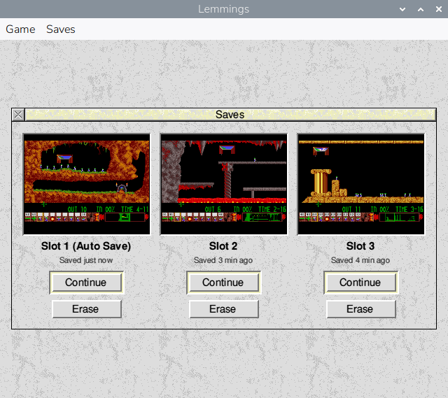
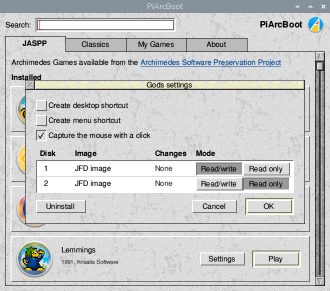

<p align="center"></p>

<h1 align="center">PiArcBoot</h1>

<p align="center"><b>Acorn Archimedes games on the Raspberry Pi.</b><br>A free launcher that installs the games released by JASPP, the Archimedes Software Preservation Project, and boots each one straight into the game on an emulated Archimedes based on <a href="https://github.com/ArcEm-emu/ArcEm">ArcEm</a>, with its own icon and shortcuts. It needs no commercial ROM.</p>

<p align="center"><a href="../../releases/latest"><b>Download for Raspberry Pi OS, Linux or Windows</b></a></p>

<p align="center">Discord: <a href="https://discord.gg/88VzuWSYUc">https://discord.gg/88VzuWSYUc</a></p>

<p align="center"></p>

Install from a terminal. On a Raspberry Pi or a Linux PC:

```bash
curl -fsSL https://github.com/jameshansen/PiArcBoot/releases/latest/download/install.sh | sh
```

On Windows, in PowerShell:

```powershell
irm https://github.com/jameshansen/PiArcBoot/releases/latest/download/install.ps1 | iex
```

## Background

I started building tools that make it easy to launch some of my, and my kids' favourite games on the Raspberry Pi, such as [Knytt](https://github.com/jameshansen/PiKnytt) and [Klass of 99](https://github.com/jameshansen/PiKlassOf99), and sharing them here for other fans of these lesser known titles.

However, some classic RISC OS games the kids used to play on RISC OS Open were missing on Raspberry Pi OS. The idea began first with the idea of just making the RISC OS version of Lemmings have a similar custom installer, but I decided to expand this project to include the other games [JASPP](https://www.jaspp.org.uk), the Archimedes Software Preservation Project, has released with their publishers' permission. The problem was making it just run-and-go - the games needed a ROM with RISC OS to start, and the RISC OS 3.11 ROM is commercial, and setting up an emulator can be complicated.

PiArcBoot solves these problems - it is a super easy to use emulator built around running these games, starting the game directly with no setup or technical knowledge required. Even the ROM issue was solved with [ROO311](https://github.com/jameshansen/ROO311), a free ROM made from the RISC OS Open sources.

PiArcBoot lists most of the JASPP games which can be quickly installed and played. Along with JASPP, the Classics tab has a collection of well-known freeware games, like Asylum and Oddball, along with the desktop games from PackMan, RISC OS Open's package manager. Disc images and zip files of your own can be loaded in the My Games tab.

The emulation core is based on [ArcEm](https://github.com/ArcEm-emu/ArcEm), with a number of enhancements, such as 1.6MB floppy support and save state support.

This is a passion project, making some of these old favourites easy to pick up and play, whenever the moment strikes.

## Games

PiArcBoot lists 113 JASPP games and 23 Classics, including:

- **JASPP**: Lemmings, Lemmings 2: The Tribes, Gods, Magic Pockets, Cannon Fodder, SpeedBall 2, Sensible Soccer, Chocks Away, Lotus Turbo Challenge 2, Populous, SimCity, James Pond, Fire & Ice, Chuck Rock and Pac-mania
- **Classics**: Elite, Star Fighter 3000, Hamsters, Asylum and Cycloids

The full list is in [GAMES.md](GAMES.md), with every game's year, publisher and how it installs.

The JASPP tab is JASPP's own package feed, cut down to the games that start the same way on ROO311 as on RISC OS 3.11. Most take over the screen, and the few that play in the RISC OS desktop, such as SimCity and Mah-Jong Patience, are shown cropped to their windows. A game JASPP adds later appears by itself once its floppy images are there, marked as untested.

PiArcBoot contains none of the games. Install downloads each game's floppy images from JASPP, which needs an internet connection, and an installed game plays offline. The emulated machine has floppy drives and nothing else, so nothing running in it can reach the files on your computer, apart from Star Fighter 3000 and the games that install onto a hard disc, each of which sees its own folder and nothing outside it.

PiArcBoot is an unofficial project and isn't affiliated with JASPP or with RISC OS Open Ltd.

## Save states

Every game in PiArcBoot has 3 save slots, and each one holds the whole emulated machine as it was at the moment it was saved, along with a screenshot of it. You can save to any slot from the Saves menu, and one slot is also saved for you every 30 seconds of play.

Once a game has saves, it opens on the selector instead of booting straight in, with the 3 slots side by side, their screenshots and how long ago each one was saved, and nothing runs until you pick one. Continue carries on from that save, New Game starts fresh in an empty slot, and whichever slot you pick becomes the one Auto Save writes to from then on. Erase deletes a save, after asking first.



Restoring a save puts back anything the game wrote to a floppy too, while files in a game's own folder stay as they are. A save made with a different ROM, or with a version of PiArcBoot whose emulated machine has changed, won't restore, and the game carries on as it was.

## Features

- **Straight into the game.** A game starts with nothing to type or click to get it going.
- **Every game is its own program**, with its own window, taskbar icon and shortcuts.
- **Any window size, and full screen**, with the picture kept sharp at every size.
- **Quick loading.** Games load from their floppies much faster than a real drive manages.
- **A3000 speed.** A game's Settings can run it at the speed of an A3000's 8 MHz ARM2 rather than a 25 MHz ARM3, for a game made for the slower machine, and can load its floppies at a real drive's speed.
- **A CRT look.** CRT-Royale-Pi and CRT-Pi in the Shaders menu draw the picture as a monitor of the time showed it, with scanlines and a phosphor mask.
- **Save states.** Every game gets 3 save slots, each one holding the whole machine as it was at that moment along with a screenshot of it. One slot is saved every 30 seconds of play, and a game with saves opens on all 3 side by side, so you can continue one or start a new game in an empty slot.
- **Search** across the game lists, and each tab shows how many of its games match.
- **Disc switching** from the Disk Drive menu or with Ctrl, Alt and a number, and auto switch points, which change the disc by themselves when a game shows the screen that asks for it. Select Disk in the same menu puts any disc image in the drive.
- **Your own disc images.** Add Game on the My Games tab turns JFD, ADF, ADL and HFE images, the usual Archimedes disc image formats, or a zip of them, into games, with the discs put in order from their names.
- **Your own archives.** A zip, Spark or ArcFS archive of RISC OS applications becomes a game too, starting from the application named after the archive, or its biggest.
- **Hard disc installs.** The games that came with a hard disc installer, such as Black Angel, Carnage Inc and Raw Power, have the files it would copy taken straight off their disc images as they install, or as their discs are added with Add Game, so they start from a folder the machine reads directly with no discs to swap.
- **Saves are kept** in a file beside each disc image, and the image itself is never changed. Any disc can be made read only.
- **Crop to Window** for a game that plays in the RISC OS desktop: the picture is cropped to the game's windows, leaving out the icon bar and the desktop around them, and it follows them as they open, close and move. The Game menu turns it on or off for any game, your own included, and the games that need it start with it on.
- **Copy protection as the disc has it**, so the games' own disc checks pass.


## What works

Tested by scripts that run the machine with no window, on x86-64 Linux (Ubuntu 26.04), a Raspberry Pi 400 with 64-bit Raspberry Pi OS 13, and Windows 10.

- All 110 games boot from their first disc to their own screens. Against reference pictures at 35 and 65 seconds, 101 match, Chocks Away Compendium gets further than its pictures, which stop at an error, and plays, 6 get there by 95 seconds (Black Angel, Empire Soccer 94, Powerband, Raw Power, Silver Ball and Thundermonk), and Botkiller 2 and the Risc PC version of Speedball 2 load from their 1.6MB discs
- The games' disc checks pass, among them Hero Quest's, Fire and Ice's and Blaston's, and what Jet Fighter writes to its boot disc is kept
- Blank discs format, take files and read back after a fresh power on
- The 11 Acorn Arcade games and 12 PackMan games in Classics install and start, Star Fighter 3000 and Meteors full screen
- Mah-Jong Patience, Premier Manager and SimCity, which play in the RISC OS desktop, start in their windows and are shown cropped to them, as Haunted House is
- The 9 games with a hard disc installer install onto a folder the machine reads directly and start from there: Black Angel, Break 147 & Superpool, Carnage Inc, Drop Ship, The Exotic Adventures of Sylvia Layne, Haunted House, Raw Power, Saloon Cars Deluxe and Stunt Racer 2000
- On the Pi 400 the emulated machine can run about 2.5 times faster than a real one, and Lemmings holds full speed in a game window

### Not yet

- Joysticks aren't supported
- Champions installs with 3 of its 5 discs, the ones JASPP's package has
- DarkWood, which needs a Risc PC, and Phaethon, which needs two drives, aren't in Classics, nor are the PackMan games that need SharedCLibrary 5, more than 4MB or a screen mode an Archimedes can't show (`presets/README.md` lists them)
- ArcElite takes 39 seconds to load from its floppy

## Install

Each system has an installer, drawn with [ROOGUI](https://github.com/jameshansen/ROOGUI), and a portable copy, both on the [latest release](../../releases/latest). PiArcBoot needs an internet connection to install games.

### Raspberry Pi

It needs 64-bit Raspberry Pi OS 13 (trixie) or newer with the desktop, SDL2 (`sudo apt install libsdl2-2.0-0` if it isn't there) and `curl`. It's tested on a Pi 400. PiArcBoot takes about 6 MB, and a game under 1 MB a disc. In a terminal:

```bash
curl -fsSL https://github.com/jameshansen/PiArcBoot/releases/latest/download/install.sh | sh
```

Or download `PiArcBoot-Installer-RaspberryPi.zip`, extract it and double-click `Install PiArcBoot`. Then in PiArcBoot, choose a game and press **Install**, then **Play**.

Running the installer again offers to update or remove PiArcBoot. Removing it keeps the games installed with it, and a game's Settings in the launcher uninstalls it. Without a desktop, as over SSH, the same command ending in `| sh -s -- --remove` removes it.

### Linux PC

The same command installs PiArcBoot on a 64-bit PC with a Linux desktop as new as Ubuntu 24.04 or Debian 13, with SDL2 and `curl`. Or download `PiArcBoot-Installer-Linux-x86-64.zip`, extract it and double-click `Install PiArcBoot`.

### Windows

It needs 64-bit Windows. In PowerShell:

```powershell
irm https://github.com/jameshansen/PiArcBoot/releases/latest/download/install.ps1 | iex
```

Or download `PiArcBoot-Installer-Windows.zip`, extract it and run `Install PiArcBoot.exe`. Games are kept in `%APPDATA%\PiArcBoot`.

### Portable

`PiArcBoot-Portable-RaspberryPi.zip`, `PiArcBoot-Portable-Windows.zip` and `PiArcBoot-Portable-Linux-x86-64.zip` run from wherever they're extracted, with nothing installed. Run `piarcboot`, or `piarcboot.exe` on Windows, in the `PiArcBoot` folder. A portable copy keeps its games and saves in the `Data` folder beside it, so they move with the folder.

## Playing

Click on the picture to give the mouse to the game. The left button is Select, the middle one Menu and the right one Adjust, as on an Archimedes.

| Key | Action |
| --- | --- |
| Ctrl+Alt+Enter | Enter or leave full screen |
| Ctrl+Alt+1 to Ctrl+Alt+9 | Put that disc in the drive |
| Ctrl+Alt+S | Save to the slot selected for Auto Save |
| Ctrl+Alt+R | Restore the slot selected for Auto Save |
| Ctrl+Alt+P | Pause the game, or carry on |
| Escape | Take the mouse back from the game, and leave full screen |
| Alt+F4 | Quit, once the game no longer has the mouse |

PiArcBoot's own shortcuts all use Ctrl+Alt, so Alt and every other key belong to the game. While the game has the mouse it has the keyboard too, including system keys like Alt+F4 and Alt+Tab, and Escape gives you both back.

Escape never reaches the game. A game that wants it gets it from **Send ESC** at the top of the Game menu, in the window's menu bar.

**Save Snapshot** in the Game menu saves what's on screen as a PNG in your Pictures folder, named after the game and the time it was taken.

**Pause** in the Game menu, or Ctrl+Alt+P, stops the game until you choose it again, and Auto Save doesn't count the time it's paused.

In full screen there is no menu bar, and Escape or Ctrl+Alt+Enter comes back to the window.

Drag the window's edge or maximize it and the picture grows to fill the frame, keeping its shape. A size you drag it to is kept for the next time the game starts, and a size from the Game menu puts the window back to an exact multiple and opens every game at that size.

**Shaders** in the Game menu draws the picture as a CRT monitor showed it. CRT-Royale-Pi has the scanlines, phosphor mask and glow of a real tube, and CRT-Pi is a lighter scanline and mask shader. A Raspberry Pi 400 keeps up with either. Off draws the picture as it is. The choice holds for every game, and while a shader is on, 1x Scale isn't available.

Each game opens in one window at a time. Starting it again while it's open says so instead of opening a second copy.

**Crop to Window** in the Game menu shows just the game's windows, for a game that plays in the RISC OS desktop, and the pointer then goes where yours is over the picture. PiArcBoot remembers the choice for each game.

The **Saves** menu has 3 slots, and each one has **Save**, which keeps the whole machine as it is right now, **Restore**, which puts it back the way that slot has it, and **Selected for Auto Save**, which is ticked for the slot that gets written every 30 seconds of play. Restoring a slot also makes it the one Auto Save writes to. Saving to another slot that already holds a save asks first. A slot holding a save from an earlier session won't be written over until you restore it, save to it or choose a slot. Restoring rolls back anything the game wrote to a floppy as well, but files in a game's own folder stay as they are.

When a game has saves, it starts on the selector, which shows the 3 slots side by side with their screenshots and when each one was saved. **Continue** restores a slot, **New Game** starts the game fresh in an empty one and **Erase** deletes a save after asking first, and whichever slot you pick becomes the one Auto Save writes to. **Open Selector** in the Saves menu brings it up during a game, which waits behind it until you close it and carry on where you were.

The **Disk Drive** menu puts one of the game's discs in the drive. To set an auto switch point, wait for the game to ask for a disc, choose **Set Auto Switch Point** and then choose the disc. **Clear Auto Switch Points** forgets them all. **Select Disk...** puts a disc image from anywhere on your computer in the drive, and what the game writes to it goes in a `.sav` file beside it, as for the game's own discs. **Hide Disk Drive Menu** in a game's Settings takes the menu away, and it's ticked by default for a game with one disc. Ctrl+Alt and a number still change the disc while the menu is hidden.

Games are kept in `~/.local/share/piarcboot/games`, a folder each, with their disc images, saved changes (`.sav`), save states (`saves/`), icon and settings.



## How it works

The machine is [ArcEm](https://github.com/ArcEm-emu/ArcEm)'s, set up as an Archimedes with a 25 MHz ARM3 and 4MB of memory, with floppy drives and nothing else, so nothing running in it can reach the files on your computer. A game with a support pack or a hard disc install is the exception, and sees only its own folder. ArcEm's processor, memory controller, IOC, VIDC, sound and keyboard are used as ArcEm has them, in `arcem/`, and PiArcBoot's own code in `src/` adds the floppy drives and connects the picture, sound, keyboard and mouse to the window. One fix is made to ArcEm's processor: a load that steps its base by a register (`LDRB r3, [r4], r3, LSL #1`) steps it by that register's value from before the load, as the ARM2 and ARM3 do, even when the load overwrites it. Star Fighter 3000's sample player does that, and its music and effects played only their first few samples without it.

The machine runs 25 million cycles to a second of its own time, a fixed rate rather than one measured against the host, so a game takes the same machine time on every computer and a test script gives the same result every time. The game window keeps it to real time a centisecond at a time.

A game boots behind the splash screen with the machine running flat out. A disc that boots gets Shift held until it is first read. For any other disc, ROO311's HostLink module runs the application once the desktop is up, the way a double-click would. HostLink then reports a screen mode change when the game takes the screen, an error box when it asks for a disc, or a new desktop task, whose icon bar icon it clicks for a game that waits to be clicked. The splash stays up until one of those. HostLink also reports where the windows on the screen are, five times a second when they change, as it walks up the Wimp's window stack from the icon bar, and with Crop to Window on, the picture is cropped to the area they cover. A game that plays in the desktop has its icon clicked once its floppy drive has been still for a second.

The floppy controller is a WD1772 written from its data sheet, with the disc turning under it at 300 rpm and each sector passing the head at its place on the track. A JFD image records each sector's place, size, number and CRC errors, which is how JASPP keeps a disc's copy protection, so the games' checks find what they would on the real disc. Botkiller 2 and the Risc PC version of Speedball 2 come on 1.6MB discs, so for those two the machine becomes an A5000, a later Archimedes, with its 82C711, whose 765 floppy controller is also written from its data sheet.

Disc images are never written to. What a game writes goes to `<image>.sav` beside the image and is laid back over it when the game next starts.

A Classics game comes as a zip of RISC OS applications, which Install lays out as ADFS D format floppy images, and it starts on a 640 by 512 desktop in 256 colours for the games that play in it. HostLink can start applications, click icon bar icons and move the pointer, and it reports screen mode changes, with how many OS units make a pixel in the new mode, error boxes and new desktop tasks, and nothing more. The pointer moves as far across the picture as your mouse does in any mode, as the OS units to a pixel say. The zips are mirrored in `distributable-games`, each with where it came from and the terms it is distributed under. Star Fighter 3000 comes from its own site.

An archive added with Add Game is laid out the same way. Spark and ArcFS archives, RISC OS's own formats, are read by `src/arc.c`: stored, packed (runs of a byte), crunched and compressed (LZW, as Unix compress wrote it) and squashed files, each checked against its CRC. The folder an archive's applications are in becomes the top of the disc, so a PackMan package's `Apps.Games.!Foo` comes out as `!Foo`, and an application whose `!Run` asks for the Toolbox, `System:`, a scrap folder or `Choices:` gets the support pack.

A game that needs more than RISC OS 3.11 had, Star Fighter 3000 so far, gets [ROO311's support pack](https://github.com/jameshansen/ROO311#support-pack), mirrored in `distributable-games/support-packs`. Its nested Window Manager goes in an extension ROM with ArcEm's HostFS module, and RISC OS takes both up at power on, the Window Manager in place of the ROM's own, since it can't be replaced once the desktop has started. The game goes in a folder that HostFS shows the machine, with the pack's `!System` of Toolbox modules and its `!Scrap`, which HostLink boots before it runs the game.

The hard disc installers of the games that came with one copy files from the game's discs and nothing more, some folders renamed and a later disc's files merged into the first's. A list in `presets/` says which, and Install copies them straight from the disc images into the folder HostFS shows the machine. `src/adfs.c` reads the discs: D format, with the old map, and E format, with the new map, where each file is one or more fragments of the map, and access bits that would stop a file being read are ignored. A copy of the folder is kept as `installed/` beside it, and the game starts from the folder through HostLink, as a support pack game does, with a fresh copy put back from `installed/` whenever the folder is missing. Disc images added with Add Game get the same, when the root of their first disc names the same applications as a game with a list. Each list was taken from what the real installer copies, and `tests/installers.sh` checks it still matches. It runs the installer in the emulator, worked by a script in `tests/installers/` that clicks in its window, types `HostFS:$` as the place to install to, and puts in each disc it asks for.

What PiArcBoot knows about particular games is in `presets/`, not its code. A game can have files that Install adds to its own, such as the choices file that starts Star Fighter 3000 full screen where it would otherwise open in a desktop window, the files its hard disc installer copies, and settings: the support pack it needs, keys to press once it has started (Escape puts Meteors on the whole screen), the screen mode for a game that plays in the desktop (MODE 15 for Black Angel), or why a PackMan game is left out. `presets/README.md` describes them.

The picture comes from ArcEm's display driver and is scaled by the graphics chip. Sound is ArcEm's mix of the VIDC's 8 channels at 48 kHz. The launcher, the installer and the splash screen use [ROOGUI](https://github.com/jameshansen/ROOGUI), a separate library that draws the RISC OS look from RISC OS Open's sprites and fonts at any display scale.

## Building

PiArcBoot is written in C on ArcEm and SDL2, and builds with `gcc` and `make`. It needs the SDL2 and zlib development packages (`libsdl2-dev` and `zlib1g-dev` on Raspberry Pi OS and Debian) and [ROOGUI](https://github.com/jameshansen/ROOGUI), a library of its own that it builds from a folder called `roogui` here, or `ROOGUI` beside this folder. `ROOGUI_REF` in `.github/workflows/build.yml` names the ROOGUI commit each release is built with.

```bash
git clone https://github.com/jameshansen/ROOGUI roogui
```

```bash
make
```

```bash
make check
```

`make check` runs the self-tests of the disc image code, the ADFS disc maker, the Spark and ArcFS readers, the icons, PNG and the game table (the list of JASPP games in `src/catalog.h`) in a few seconds, with no games needed. The About tab shows the version, which `make VERSION=1.2.3` sets and which is otherwise git's name for the commit.

The Windows build runs on Windows from Git Bash, or on Linux, with [zig](https://ziglang.org) 0.16, and the script's opening comment says where SDL2 and zlib come from.

```bash
sh tools/build-windows.sh <SDL2 folder> <zlib folder>
```

| Path | What it is |
| --- | --- |
| `arcem/` | The machine, in ArcEm's own files |
| `src/` | PiArcBoot's own code: the machine's layer over ArcEm, the floppy controllers and disc images, the launcher, the installer and the game window |
| `tests/` | Scripts that boot every game in the table, compare pictures and test writing to discs |
| `tools/` | The Windows build, the front of the installer and what packs it, and the script that makes the game table |
| `icons/` | The games' icons, made from their sprites |
| `presets/` | Files Install adds to a game, such as a choices file that suits PiArcBoot's window, settings, and what games' hard disc installers copy |
| `docs/` | Screenshots and release notes |
| `ROM311` | The ROM image from ROO311's releases |
| `distributable-games/` | The Classics games' zips, kept for installing from and not part of a release |
| `install.sh`, `install.ps1` | Download a release's installer and run it, from a terminal |

GitHub Actions builds the Raspberry Pi, Linux PC and Windows downloads on every push, and a version tag such as `v1.0.0` publishes them as a release, with `docs/releases/v1.0.0.md` as its notes.

## Feedback

A game that doesn't work, or anything else, can be reported in [Issues](../../issues) or on the Discord.

## Pi Projects

PiArcBoot is one of five projects for the Raspberry Pi. One is a utility for the desktop, and four bring favourite old games to the Pi with the same kind of installer.

| Project | What it is |
| --- | --- |
| [PiOSBeachBall](https://github.com/jameshansen/PiOSBeachBall) | A spinning beachball pointer that shows when an app is loading. |
| [PiKnytt](https://github.com/jameshansen/PiKnytt) | Knytt, the 2006 exploration platformer by Nifflas, installed and ready to play. |
| [PiKlassOf99](https://github.com/jameshansen/PiKlassOf99) | Klass of 99, Richard Jordan's Skool Daze remake, installed and ready to play. |
| [PiPakoon](https://github.com/jameshansen/PiPakoon) | Pakoon 0, 1 and 2, Mikko Oksalahti's driving games, built for the Pi with a launcher to pick between them. |
| **PiArcBoot** | Acorn Archimedes games from JASPP, installed and booted straight into the game. |

## AI use disclosure

PiArcBoot was built using [Claude Code](https://claude.com/claude-code) with Claude Fable 5.2 and Claude Opus 5.5.

## Credits

The games are released by [JASPP](https://www.jaspp.org.uk), which also defined the JFD disc image format. Each game remains the work of its authors and publisher, named beside it in the list.

The Classics are freeware thanks to their authors and rights holders and to [Acorn Arcade](http://www.acornarcade.com/articles/Free_games/index879.html), which obtained the permission to distribute them, to Christopher Bazley, who maintains [Star Fighter 3000](http://starfighter.acornarcade.com) and gives its latest release away, and to the authors of the games in [RISC OS Open's package sources](https://packages.riscosopen.org/).

The machine is [ArcEm](https://github.com/ArcEm-emu/ArcEm), the Acorn Archimedes emulator by David Alan Gilbert, Peter Naulls, Peter Howkins, Matthew Howkins, Jeffrey Lee, Daniel Clarke, Cameron Cawley and its other contributors, whose processor began as the ARMulator of Advanced RISC Machines Ltd.

The ROM is [ROO311](https://github.com/jameshansen/ROO311), built from the sources [RISC OS Open](https://www.riscosopen.org) publishes.

The launcher and the installer are drawn by [ROOGUI](https://github.com/jameshansen/ROOGUI), with the Window Manager's sprites and the Homerton font from the RISC OS Open sources. Windows, sound and input go through [SDL2](https://www.libsdl.org), and compression through zlib.

CRT-Royale-Pi is made from TroggleMonkey's CRT-Royale, and CRT-Pi is by davej, both from the GLSL versions in [libretro's shader collection](https://github.com/libretro/glsl-shaders).

PiArcBoot's icon is the Archimedes badge, its triangular A in red and yellow on blue, redrawn in code for this project. The Archimedes name and badge were trademarks of Acorn Computers.

## Licence

PiArcBoot is free software under the GNU General Public License v3.0, in [LICENSE](LICENSE). The floppy disc controllers and the disc image code (`src/wd1772.c`, `src/82c711.c`, `src/disc.c` and `src/disc.h`) are under the GNU General Public License, version 2 or any later version, as each of those files says, with version 2's text in `arcem/COPYING`. ArcEm's files in `arcem/` keep their own notices: ArcEm is under the GNU General Public License, version 2 or any later version, and is used here under version 3. `arcem/COPYING` is the licence ArcEm ships. `src/hostfsmod.h` holds ArcEm's HostFS module, assembled from `arcem/support_modules/hostfs/hostfs.s`.

`ROM311` is ROO311, under the Apache License, version 2.0. It is a separate work that the program loads, and its source is in the ROO311 repository, as is that of its support pack, which Install downloads for the games that need it. The icons in `icons/` are made from each game's own sprite and remain the copyright of the games' publishers. ROOGUI is a separate library under the Apache License, version 2.0, as are the RISC OS Open sprites and font outlines it carries. It ships beside the program as `libroogui.so`, or `roogui.dll` on Windows, with its licence in `LICENSE-ROOGUI`.

The shaders in `shaders/` are under the GNU General Public License, version 2 or any later version, with their own notices, and CRT-Royale's licence text is in `shaders/crt/shaders/crt-royale`. CRT-Royale-Pi is CRT-Royale's passes changed, as each changed file and its preset say.
