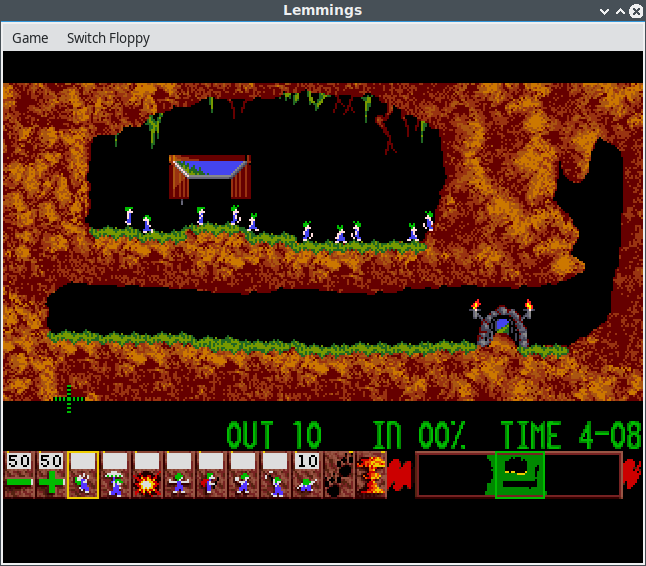
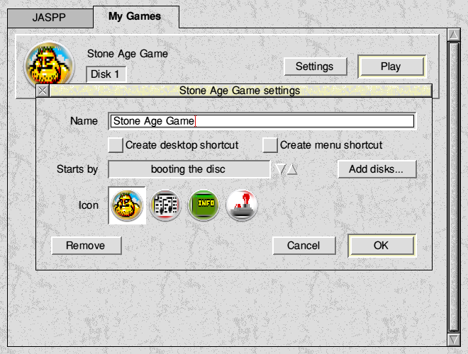

<p align="center"></p>

<h1 align="center">PiArcBoot</h1>

<p align="center"><b>Acorn Archimedes games on the Raspberry Pi.</b><br>A launcher that installs the games JASPP has released, boots each one straight into the game from its floppy images, and gives each its own icon and shortcuts. It needs no commercial ROM.</p>

<p align="center"><a href="../../releases/latest"><b>Download for Raspberry Pi OS, Linux or Windows</b></a></p>

<p align="center">Discord: <a href="https://discord.gg/88VzuWSYUc">https://discord.gg/88VzuWSYUc</a></p>


## Background

I grew up with some of these games on the Acorn Archimedes, a British home computer from the late 1980s and early 1990s. I've been building tools that make it easy to launch some of my, and my kids' favourite games on the Raspberry Pi, such as [Knytt](https://github.com/jameshansen/PiKnytt) and [Klass of 99](https://github.com/jameshansen/PiKlassOf99), and sharing them here for other fans of these lesser known titles.

I wanted to add the RISC OS version of Lemmings to that list, along with the other games [JASPP](https://www.jaspp.org.uk), the Archimedes Software Preservation Project, has released with their publishers' permission. The problem is that these games need a RISC OS ROM to start, and the RISC OS 3.11 ROM is commercial, so I built [ROO311](https://github.com/jameshansen/ROO311), a free ROM made from the RISC OS Open sources, to remove that block. PiArcBoot is the tool it was built for, and ROO311 comes with it.

PiArcBoot lists 110 of the JASPP games. Install fetches a game from JASPP and Play starts it in a window of its own, with no ROM to find, no emulator to set up and no desktop to click through. Each game boots behind a splash screen on an Archimedes emulated by [ArcEm](https://github.com/ArcEm-emu/ArcEm), and the window shows it once the game has a screen of its own.

The Classics tab has freeware that comes as RISC OS applications rather than disc images, such as Hamsters, Cycloids, Asylum and Oddball (former commercial games their authors and publishers let Acorn Arcade give away), along with the desktop games in RISC OS Open's PackMan sources. Install turns each one into floppy images, and it starts straight into play the same way the JASPP games do. Disc images of your own become games too, with an icon made from a sprite on the disc.

## The games

The JASPP tab is JASPP's own package feed, cut down to the games that ROO311's tests show starting the same way as on RISC OS 3.11 and that run full screen. A game JASPP adds later appears by itself once its floppy images are there, marked as untested.

PiArcBoot contains none of the games. Install downloads each game's floppy images from JASPP. Champions installs with the 3 of its 5 discs that its package holds, since it has no release folder.

PiArcBoot is an unofficial project and isn't affiliated with JASPP or with RISC OS Open Ltd.

## Features

- **Straight into the game.** The keys that start a game are pressed for it behind a splash screen, and the picture appears when the game puts up its first screen.
- **Every game is its own program**, with its own window, taskbar icon and shortcuts.
- **Any window size, and full screen**, with the picture kept sharp at every size.
- **Disk switching** from the Switch Floppy menu or with Alt and a number, and auto switch points that change the disk by themselves when a game asks for one.
- **Classics**, a second tab of free games from Acorn Arcade and RISC OS Open's PackMan sources.
- **Your own disc images.** JFD, ADF, ADL and HFE images, or a zip of them, become games, with the discs put in order from their names.
- **Saves are kept** in a file beside each disc image, and the image itself is never changed. Any disk can be made read only.
- **Copy protection as the disc has it**, so the games' own disc checks pass.
- **No commercial ROM.** ROO311 is free and comes in the package.



## What works

Tested on x86-64 Linux (Ubuntu 26.04), a Raspberry Pi 400 with 64-bit Raspberry Pi OS 13, and Windows 10.

- All 110 games boot from their first disc to their own screens. Against reference pictures at 35 and 65 seconds, 102 match and 6 get there by 95 seconds (Black Angel, Empire Soccer 94, Powerband, Raw Power, Silver Ball and Thundermonk)
- Botkiller 2 and Speedball 2 [RPC] load from their 1.6MB discs
- The games' disc checks pass, among them Hero Quest's, Fire and Ice's and Blaston's, and what Jet Fighter writes to its boot disc is kept
- Blank discs format, take files and read back after a fresh power on (`tests/writes.sh`)
- The 10 Acorn Arcade games and 11 PackMan games in Classics install and start
- Two runs of the same script end the same to the last byte, on the Pi 400 as on x86-64
- On the Pi 400 the machine runs about 2.5 times faster than real time flat out, and Lemmings holds full speed in a game window

### Not yet

- APD images aren't read
- Games that run inside the RISC OS desktop aren't listed, and joysticks aren't supported
- DarkWood, which needs a Risc PC, Phaethon, which needs two drives, and Star Fighter 3000 aren't in Classics, nor are PackMan games that need more than RISC OS 3.11 has
- ArcElite takes 39 seconds of machine time to load from its floppy
- This version hasn't been tried in real windows on the Pi's own screen or on Windows, its sound hasn't been listened to, and no game has been played through

## Install

### Raspberry Pi

1. Download `PiArcBoot.tar.gz` from the [latest release](../../releases/latest) and extract it. In the file manager, right-click the file and choose Extract Here.
2. Open the `PiArcBoot` folder, double-click `install.sh` and choose Execute.
3. Choose **Install**, then **Play Now**. In PiArcBoot, choose a game and press **Install**, then **Play**.

From a terminal the same thing is:

```bash
tar -xzf PiArcBoot.tar.gz && PiArcBoot/install.sh
```

It needs 64-bit Raspberry Pi OS 13 (trixie) or newer with the desktop, SDL2 (`sudo apt install libsdl2-2.0-0` if it isn't there) and `curl`. PiArcBoot itself takes 4 MB in `Games/PiArcBoot`, and a game takes under 1 MB a disc.

Running `install.sh` again offers to reinstall or remove PiArcBoot. Removing it leaves the games installed with it where they are.

### Linux PC

`PiArcBoot-Linux-x86-64.tar.gz` installs the same way on a 64-bit PC with a Linux desktop as new as Ubuntu 24.04 or Debian 13, with SDL2, `curl` and `zenity`.

### Windows

Download `PiArcBoot-Windows.zip` from the [latest release](../../releases/latest), extract it anywhere and run `piarcboot.exe` in the `PiArcBoot` folder. It needs 64-bit Windows. Nothing is installed: games are kept in `%APPDATA%\PiArcBoot`, and to remove PiArcBoot, delete the folder.

## Playing

Click on the picture to give the mouse to the game. The left button is Select, the middle one Menu and the right one Adjust, as on an Archimedes.

| Key | Action |
| --- | --- |
| Alt+Enter | Enter or leave full screen |
| Alt+1 to Alt+9 | Put that disk in the drive |
| Escape | Take the mouse back from the game |
| Alt+F4 | Quit |

Escape never reaches the game. A game that wants it gets it from **Send ESC** at the bottom of the Game menu.

In full screen there is no menu bar. A bar with the two menus comes down when the pointer touches the top of the screen, once the mouse is free.

Drag the window's edge or maximize it and the picture grows to fill the frame, keeping its shape. A size from the Game menu puts the window back to an exact multiple.

To set an auto switch point, wait for the game to ask for a disk, choose **Set Auto Switch Point** from the Switch Floppy menu and then choose the disk. **Clear Auto Switch Points** forgets them all.

Games are kept in `~/.local/share/piarcboot/games`, a folder each, with their disc images, saved changes (`.sav`), icon and settings.



## How it works

The machine is [ArcEm](https://github.com/ArcEm-emu/ArcEm)'s, set up as an Archimedes with a 25 MHz ARM3 and 4MB of memory, with floppy drives and nothing else, so nothing running in it can reach the files on your computer. ArcEm's processor, memory controller, IOC, VIDC, sound and keyboard are used as ArcEm has them, in `arcem/`, and PiArcBoot's own code in `src/` adds the floppy drives, the picture, the sound and the input.

The machine runs 25 million cycles to a second of its own time, a fixed rate rather than one measured against the host, so a game takes the same machine time on every computer and a test script gives the same result every time. The game window keeps it to real time a centisecond at a time.

A game boots behind the splash screen with the machine running flat out. A disc that boots gets Shift held until it is first read, and any other disc has its application run the way a double-click would. The splash comes down when the game sets a screen mode after it has begun loading.

The floppy controller is a WD1772 written from its data sheet, with the disc turning under it at 300 rpm and each sector passing the head at its place on the track. A JFD image records each sector's place, size, number and CRC errors, which is how JASPP keeps a disc's copy protection, so the games' checks find what they would on the real disc. Botkiller 2 and Speedball 2 [RPC] come on 1.6MB discs, so for them the machine is an A5000 with its 82C711, whose 765 floppy controller is also written from its data sheet.

Disc images are never written to. What a game writes goes to `<image>.sav` beside the image and is laid back over it when the game next starts.

A Classics game comes as a zip of RISC OS applications, which Install lays out as ADFS D format floppy images. ROO311 carries a small module, HostLink, that lets PiArcBoot start the application and click its icon bar icon. The zips are mirrored in `distributable-games`, each with where it came from and the terms it is distributed under.

The picture comes from ArcEm's display driver and is scaled by the graphics chip, with pixels repeated to the nearest whole size and only the edges between them blended, so it stays sharp at any window size. Sound is ArcEm's mix of the VIDC's 8 channels at 48 kHz, resampled slightly to keep about 80 ms queued. The launcher, the splash screen and the drawn menu bar use [ROOGUI](https://github.com/jameshansen/ROOGUI), a separate library that draws the RISC OS look from RISC OS Open's sprites and fonts at any display scale.

## Building

It builds with `gcc` and `make`, and needs the SDL2 and zlib development packages (`libsdl2-dev` and `zlib1g-dev` on Raspberry Pi OS and Debian). [ROOGUI](https://github.com/jameshansen/ROOGUI) is built by its own Makefile from a folder called `roogui` in this one, or `ROOGUI` beside it, into `build/libroogui.so` beside the program.

```bash
make
```

```bash
make check
```

The About tab shows the version, which `make VERSION=1.2.3` sets and which is otherwise git's name for the commit. The Windows build uses [zig](https://ziglang.org), and the script's opening comment says where SDL2 and zlib come from.

```bash
sh tools/build-windows.sh <SDL2 folder> <zlib folder>
```

| Path | What it is |
| --- | --- |
| `arcem/` | The machine, in ArcEm's own files |
| `src/` | PiArcBoot's own code: the machine's layer over ArcEm, the floppy controllers and disc images, the launcher and the game window |
| `tests/` | Scripts that boot every game in the table, compare pictures and test writing to discs |
| `tools/` | The Windows build and the script that makes the game table |
| `icons/` | The games' icons, made from their sprites |
| `ROM311` | The ROO311 ROM image |
| `distributable-games/` | The Classics games' zips, kept for installing from and not part of a release |
| `install.sh` | The installer for Raspberry Pi OS and other Linux desktops |

GitHub Actions builds the Raspberry Pi, Linux PC and Windows downloads on every push, and a version tag such as `v1.0.0` publishes them as a release, with `docs/releases/v1.0.0.md` as its notes.

## Pi Projects

PiArcBoot is one of five projects for the Raspberry Pi. One is a utility for the desktop, and four bring favourite old games to the Pi with the same kind of installer.

| Project | What it is |
| --- | --- |
| [PiOSBeachBall](https://github.com/jameshansen/PiOSBeachBall) | A spinning beachball pointer that shows when an app is loading. |
| [PiKnytt](https://github.com/jameshansen/PiKnytt) | Knytt, the 2006 exploration platformer by Nifflas, installed and ready to play. |
| [PiKlassOf99](https://github.com/jameshansen/PiKlassOf99) | Klass of 99, Richard Jordan's Skool Daze remake, installed and ready to play. |
| [PiPakoon](https://github.com/jameshansen/PiPakoon) | Pakoon 0, 1 and 2, Mikko Oksalahti's driving games, built for the Pi with a launcher to pick between them. |
| **PiArcBoot** | Acorn Archimedes games from JASPP, installed and booted straight into the game. |

## AI use disclosure

PiArcBoot was built using [Claude Code](https://claude.com/claude-code) with Claude Fable 5.2 and Claude Opus 5.5.

## Credits

The games are released by [JASPP](https://www.jaspp.org.uk), which also defined the JFD disc image format. Each game remains the work of its authors and publisher, named beside it in the list.

The Classics are freeware thanks to their authors and rights holders and to [Acorn Arcade](http://www.acornarcade.com/articles/Free_games/index879.html), which obtained the permission to distribute them, and to the authors of the games in [RISC OS Open's package sources](https://packages.riscosopen.org/).

The machine is [ArcEm](https://github.com/ArcEm-emu/ArcEm), the Acorn Archimedes emulator by David Alan Gilbert, Peter Naulls, Peter Howkins, Matthew Howkins, Jeffrey Lee, Daniel Clarke, Cameron Cawley and its other contributors, whose processor began as the ARMulator of Advanced RISC Machines Ltd.

The ROM is [ROO311](https://github.com/jameshansen/ROO311), built from the sources [RISC OS Open](https://www.riscosopen.org) publishes.

The launcher is drawn by [ROOGUI](https://github.com/jameshansen/ROOGUI), with the Window Manager's sprites and the Homerton font from the RISC OS Open sources. Windows, sound and input go through [SDL2](https://www.libsdl.org), and compression through zlib.

PiArcBoot's icon is the Archimedes badge, its triangular A in red and yellow on blue, redrawn in code for this project. The Archimedes name and badge were trademarks of Acorn Computers.

## Licence

PiArcBoot is free software under the GNU General Public License v3.0, in [LICENSE](LICENSE). The floppy disc controllers and the disc image code (`src/wd1772.c`, `src/82c711.c`, `src/disc.c` and `src/disc.h`) are under the GNU General Public License, version 2 or any later version, as each of those files says, with version 2's text in `arcem/COPYING`. ArcEm's files in `arcem/` keep their own notices: ArcEm is under the GNU General Public License, version 2 or any later version, and is used here under version 3. `arcem/COPYING` is the licence ArcEm ships.

`ROM311` is ROO311, under the Apache License, version 2.0. It is a separate work that the program loads, and its source is in the ROO311 repository. The icons in `icons/` are made from each game's own sprite and remain the copyright of the games' publishers. ROOGUI is a separate library under the Apache License, version 2.0, as are the RISC OS Open sprites and font outlines it carries. It ships beside the program as `libroogui.so`, or `roogui.dll` on Windows, with its licence in `LICENSE-ROOGUI`.
