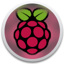

## Download

| | Download | |
|---|---|---|
|  **Raspberry Pi** | [PiArcBoot.tar.gz](https://github.com/jameshansen/PiArcBoot/releases/download/{TAG}/PiArcBoot.tar.gz) | Extract it, open the `PiArcBoot` folder, double-click `install.sh` and choose Execute, then choose **Install**. It needs 64-bit Raspberry Pi OS 13 (trixie) or newer |
|  **Windows** | [PiArcBoot-Windows.zip](https://github.com/jameshansen/PiArcBoot/releases/download/{TAG}/PiArcBoot-Windows.zip) | Extract it anywhere and run `piarcboot.exe` in the `PiArcBoot` folder |
|  **Linux** | [PiArcBoot-Linux-x86-64.tar.gz](https://github.com/jameshansen/PiArcBoot/releases/download/{TAG}/PiArcBoot-Linux-x86-64.tar.gz) | Installs as on the Raspberry Pi, on a 64-bit PC desktop as new as Ubuntu 24.04 or Debian 13 |

---

