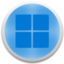

## Download

| | Installer | Portable | |
|---|---|---|---|
|  **Raspberry Pi** | [PiArcBoot-Installer-RaspberryPi.zip](https://github.com/jameshansen/PiArcBoot/releases/download/{TAG}/PiArcBoot-Installer-RaspberryPi.zip) | [PiArcBoot-Portable-RaspberryPi.zip](https://github.com/jameshansen/PiArcBoot/releases/download/{TAG}/PiArcBoot-Portable-RaspberryPi.zip) | 64-bit Raspberry Pi OS 13 (trixie) or newer |
|  **Windows** | [PiArcBoot-Installer-Windows.zip](https://github.com/jameshansen/PiArcBoot/releases/download/{TAG}/PiArcBoot-Installer-Windows.zip) | [PiArcBoot-Portable-Windows.zip](https://github.com/jameshansen/PiArcBoot/releases/download/{TAG}/PiArcBoot-Portable-Windows.zip) | 64-bit Windows |
|  **Linux** | [PiArcBoot-Installer-Linux-x86-64.zip](https://github.com/jameshansen/PiArcBoot/releases/download/{TAG}/PiArcBoot-Installer-Linux-x86-64.zip) | [PiArcBoot-Portable-Linux-x86-64.zip](https://github.com/jameshansen/PiArcBoot/releases/download/{TAG}/PiArcBoot-Portable-Linux-x86-64.zip) | A 64-bit PC desktop as new as Ubuntu 24.04 or Debian 13 |

Extract the installer and run `Install PiArcBoot`. A portable copy runs from wherever it's extracted and keeps its games and saves in its own `Data` folder.

Or install from a terminal. On a Raspberry Pi or a Linux PC:

```bash
curl -fsSL https://github.com/jameshansen/PiArcBoot/releases/download/{TAG}/install.sh | sh
```

On Windows, in PowerShell:

```powershell
irm https://github.com/jameshansen/PiArcBoot/releases/download/{TAG}/install.ps1 | iex
```

---
